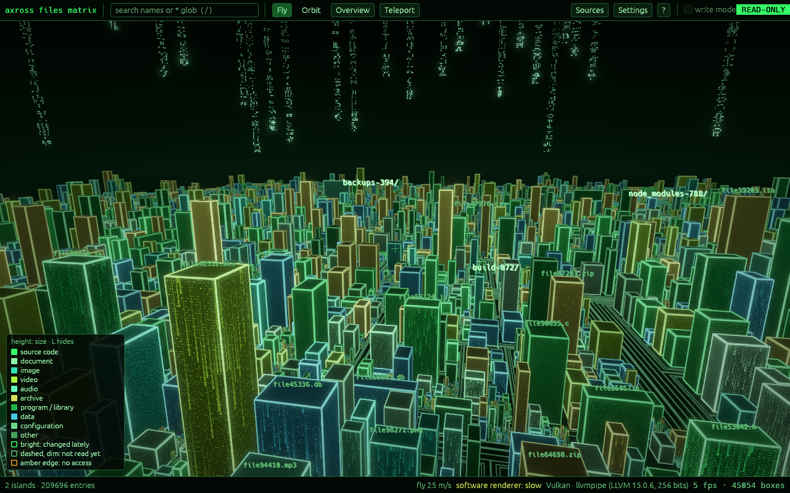
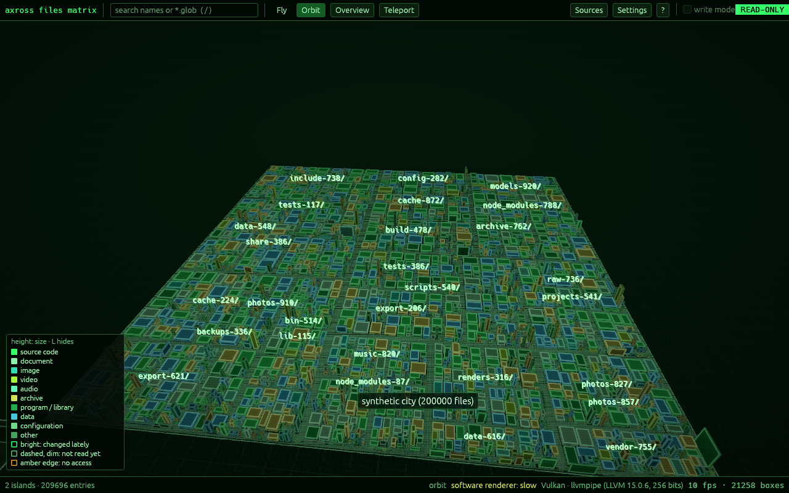
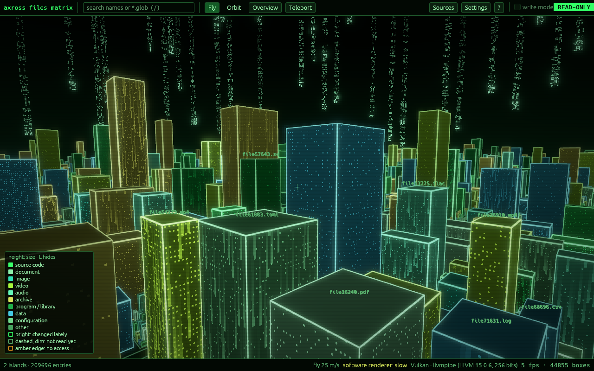
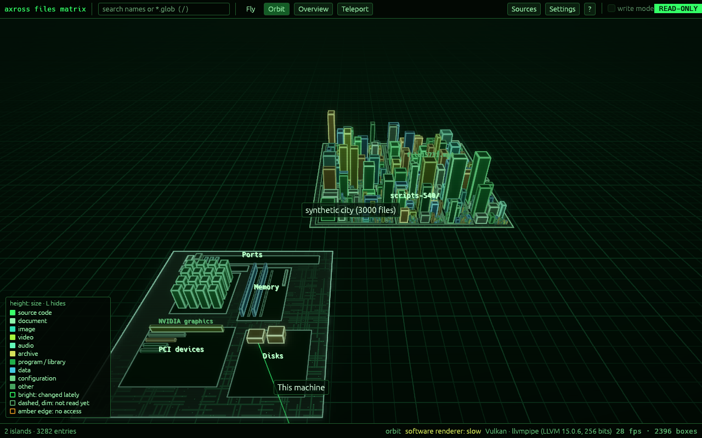
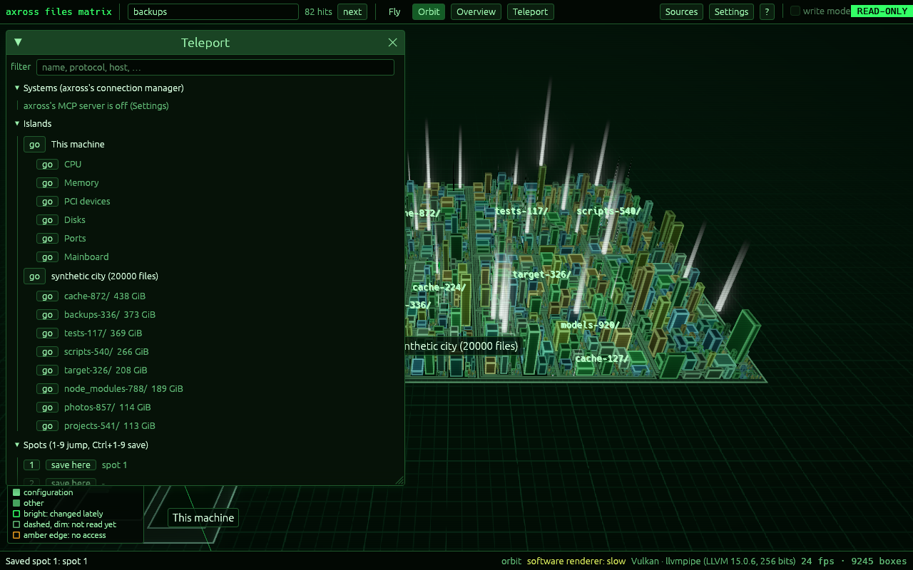
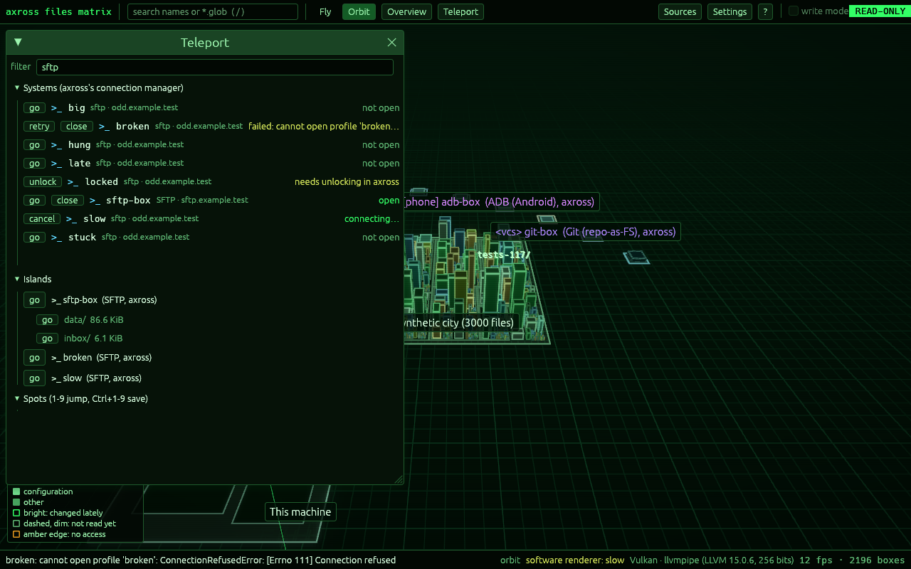

# axross-files-matrix

The data on your mountpoints as a 3D city you fly through - Matrix style,
with real file access. Written in Rust (wgpu and egui), a companion of
[axross](https://github.com/c0decave/axross).



- **Every mountpoint is an island** - the local disks, every mount the
  system shows (pseudo file systems hidden), and, when axross is installed,
  every remote backend of its MCP server (SFTP, S3, WebDAV, ...)
- **Folders are districts, files are buildings** - a squarified treemap by
  bytes with streets between the districts; a building's footprint and
  height by its size, its colour by its type, its glow by how recently it
  changed
- **The machine is an island too** - the mainboard as the ground plan, the
  processor's cores as towers lit by their load, the memory's modules in
  their slots, the PCIe cards, the disks - and a beam of light from each
  disk to the islands that live on it
- **Huge trees** - the walk streams in the background and the city grows
  while you watch; far districts are single blocks that open as you come
  near (unread folders are read then); the last walk is cached, so the city
  stands at once on the next start
- **Fly** - free flight with WASD and the mouse, or orbit and map; flights
  that keep above the roofs; teleport to islands, districts, saved spots
  (1-9) and search hits
- **Teleport to other systems** - every connection saved in axross's
  connection manager, of any protocol axross has a backend for (SSH/SFTP,
  NFS, SMB, S3, WebDAV, cloud drives, phones, mail, databases, git, ...):
  chosen in the Teleport menu, it is connected through axross, its island
  rises at once and is walked while the camera flies there
- **Find, inspect, open** - search by name or glob, hits as pillars of
  light; details and a preview of text, images and bytes; open in axross or
  with the system's program
- **Read-only** - nothing on any disk is changed in this release (file
  operations with pick-up-and-fly come later)
- **Guarded against flashes** - the picture is measured on the GPU and
  veiled where it would flash more than three times a second, as in
  [axross-amp](https://github.com/c0decave/axross-amp)
  ([Photosensitivity](docs/FLASH_SAFETY.md))

> **Photosensitivity warning.** The city moves: digital rain, flights, the
> teleport's warp. The picture is guarded against flashes (WCAG 2.3.1 and
> 2.3.2: at most three flashes a second, no saturated red flashes), but it
> is not guaranteed safe for everyone. *Settings › Reduce motion* stops the
> rain and the warp. If you or anyone watching has epilepsy or feels
> unwell, stop.

## Screenshots

<table>
  <tr>
    <td></td>
    <td></td>
  </tr>
  <tr>
    <td></td>
    <td></td>
  </tr>
  <tr>
    <td></td>
    <td></td>
  </tr>
  <tr>
    <td></td>
    <td></td>
  </tr>
</table>

<sub>The cities in the pictures are made-up trees (`--synthetic`), the
machine a made-up one; the pictures are rendered by the tests
(`AFM_SHOTS=docs cargo test --test screenshots`).</sub>

## Install

Each [release](https://github.com/c0decave/axross-files-matrix/releases)
has the files and their `SHA256SUMS` (signed by the maintainer):

| System | File |
|---|---|
| Linux x86_64 | `axross-files-matrix-X.Y.Z-x86_64.AppImage`, or the `.tar.gz` (glibc 2.34 or later) |
| macOS (Apple silicon and Intel) | `axross-files-matrix-X.Y.Z-macos-universal.dmg` |
| Windows x64 | `axross-files-matrix-X.Y.Z-windows-x64.zip` |

Or with cargo: `cargo install axross-files-matrix`.

It needs a GPU that Vulkan, Metal, DirectX 12 or OpenGL can reach (a
software renderer works, slowly).

For remote backends install axross's MCP server -
`pip install axross-headless-mcp` (or run it once with
`uvx axross-headless-mcp`) - or axross itself; the city finds it on the
PATH. Without it: local disks and mounts only.

## GPU

The city is drawn by [wgpu](https://wgpu.rs) - Vulkan, Metal, DirectX 12
or OpenGL, whichever the system has; no vendor's own toolkit is needed.
The dedicated GPU is preferred (*Settings › GPU*: automatic, high
performance, low power - from the next start). The status line says what
draws the city (`Vulkan · <adapter>`), and says so calmly when it is a
software renderer (llvmpipe, lavapipe, WARP): that works, a few frames a
second.

Overrides, for a start from a terminal:

| Variable | |
|---|---|
| `WGPU_BACKEND` | the API: `vulkan`, `metal`, `dx12`, `gl` |
| `WGPU_ADAPTER_NAME` | a part of the adapter's name, e.g. `nvidia`, `radeon`, `intel` |
| `WGPU_POWER_PREF` | `high` or `low` (when the setting is automatic) |

`axross-files-matrix --benchmark` measures it on your machine: a city of
200 000 files flown through for 600 frames offscreen (no vsync), with the
adapter, the boxes and draw calls per frame, and the CPU side and the whole
frame as median, p95 and p99 (`--json` for the numbers, `--all` to draw
every building with no level of detail, `--size 3840x2160`).

## Use

```sh
axross-files-matrix                 # every mountpoint, axross's backends, the machine
axross-files-matrix ~/projects /srv # islands of these folders only
axross-files-matrix --synthetic 200000   # a made-up city, to look at
axross-files-matrix --dump-city DIR --json   # the city as JSON, no window
axross-files-matrix -- -odd-name    # after `--` every argument is a folder
```

`--help` lists every option. Started from a terminal it goes to the
background (`--foreground` keeps it there).

### Controls

| Key / mouse | |
|---|---|
| W A S D (arrows) | fly forward, left, back, right |
| Q / E | down / up |
| Shift | five times as fast |
| wheel | flight speed; in orbit: zoom |
| right drag | look around (fly) / turn (orbit) |
| M | capture the mouse to look (Esc lets go) |
| Esc | let the mouse go, give a connect up, clear the choice |
| F | free flight / orbit and map |
| drag, Shift+drag | orbit: turn, pan |
| click | choose (orbit: and fly there); double-click: fly there |
| / or Ctrl+F | search (text, or a glob like `*.iso`) |
| N / Enter | fly to the next hit (Shift: teleport) |
| T | teleport menu: other systems, islands, districts, spots, hits |
| 1 - 9, Ctrl+1 - 9 | jump to a saved spot, save one |
| Home | overview |
| O / Shift+O | open in axross / with the default program |
| L | the colour legend |
| H / F1 | help |

**Other systems.** The Teleport menu (T) lists every connection saved in
axross's connection manager, with its protocol, host and state (not open,
connecting, walking, open, failed with the reason); the filter at its top
searches the systems, islands, districts, spots and hits at once. *go*
connects one through axross's MCP server (started read-only with its
`remote` tool group; Sources says the command line), raises its island at
once - "connecting…" - and flies there; a connect has a time limit, and
*cancel* (or Esc) gives it up. A failure stays on the island and in the
menu, with *retry*. The protocols come from axross's own registry at run
time: a family has its sign and colour (shell logins, shares, cloud stores,
phones, mail, databases, version control), any other protocol the generic
look. A backend that tells no sizes gets equal footprints and says so; mail
stores, databases and slow backends are read folder by folder as you come
near. A saved spot (Ctrl+1-9) inside a system opens it again when you jump
to it. *close* ends a system (axross's server keeps at most 8 open; when
they are taken, the window says which and offers to close the one visited
longest ago). The matrix never asks for or keeps a password: a system that needs
one axross has not stored says "needs unlocking in axross" and opens
axross's connection manager (`axross --connection-manager=NAME`, 0.15.186
and later), where it can be stored.

**Opening.** *Open in axross* needs axross 0.15.186 or later (it is asked
once whether it takes a path: `axross -- PATH`, and for a remote backend
`axross --profile=NAME -- PATH`); an older axross is said to be too old and
nothing else is started in its place. *Show in file manager* opens the
file's folder and runs nothing. *Open* hands the file to the system's
default program - for a program, a script, a desktop entry, a shortcut, an
executable, a link, or anything on a removable medium or a network file
system it asks first and offers the file manager instead.

### What you see

- **Islands**: the machine in the middle, the local mounts in a ring round
  it, axross's remote backends further out (bluish). The beams run from a
  disk on the machine's island to the islands on it.
- **Buildings**: colour by type - source code bright green, documents pale,
  images teal, video lime, audio mint, archives gold, programs deep green,
  data blue, configuration soft green. Recently changed files glow and
  have more lit windows.
- **Blocks**: a far district drawn as one block in the colour of what fills
  it most. Dashed outlines: a folder not read yet. Amber outlines: a folder
  that could not be read. The legend in the view's corner says all of this
  (L hides it).
- **Sizes**: by the space a file takes on the disk (a sparse 4 GB file is
  small), every file with a least footprint; a setting sizes by length.

### Names in every script

egui's own fonts draw Latin, Greek and Cyrillic. For Chinese, Japanese,
Korean, Arabic, Hebrew, Indic scripts, Thai and symbols the window looks
among the system's fonts (on a thread of its own, a few seconds at most)
and adds what it finds - on Linux for example the packages
`fonts-noto-cjk` and `fonts-noto-core`. `AFM_FONT_DIRS` names more folders
to look in. A character no font has is drawn as a box.

### Settings

In the configuration folder (`~/.config/axross-files-matrix/settings.json`
on Linux): read-only (the only mode in this release), the question before
the flight, pseudo file systems and bind mounts, the machine's island,
sizes on the disk or by length, axross's server and its command, the walk
cache (its size and age, whether removable, network and remote islands are
kept, a button that clears it), the look (labels, rain, bloom, scanlines,
smooth edges, frames a second while idle, reduce motion), the mouse,
updates. A file that cannot be read is set aside, not fatal. The walk
cache lives in the cache folder (`~/.cache/axross-files-matrix/`), a
folder and files only you can read.

## Building

```sh
cargo build --release
cargo test
cargo run --release -- --benchmark    # frame times on this machine's GPU
cargo run --release -- --benchmark 200000 --flat   # one folder of 200 000 files
cargo run --release --example bench   # also the walk, the layout and the memory
```

What the bench measures with 200 000 files: the city is laid out in about
30 ms on its own thread; the level of detail picks 25 000 - 60 000 boxes a
frame in 0.1 - 2 ms (all 200 000 buildings opened: about 1 ms); every box
is one instance of a single draw call. Walking a real tree of 200 000
files (warm, four readers) takes about 0.35 s. The window keeps its own
work per frame near 1 ms; the frame rate then depends on the GPU (a
software renderer - Mesa's llvmpipe - needs 0.2 s for a 1080p frame).

Rust 1.95 or later (what egui 0.37 and wgpu 30 need). Linux needs nothing beyond a C compiler (for `ring`);
the tests render with any wgpu adapter (Mesa's lavapipe on CI).

Releasing: [docs/RELEASING.md](docs/RELEASING.md).

## Licence

Apache-2.0 ([LICENSE](LICENSE)); what it is built from:
[THIRD_PARTY_LICENSES.md](THIRD_PARTY_LICENSES.md).
